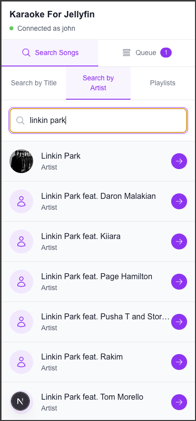
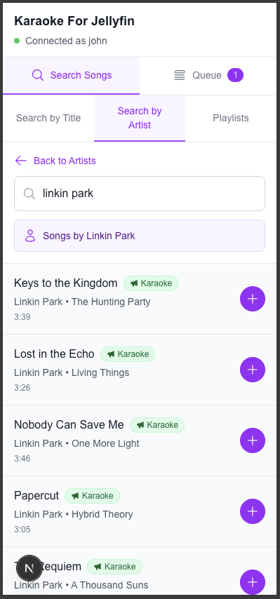
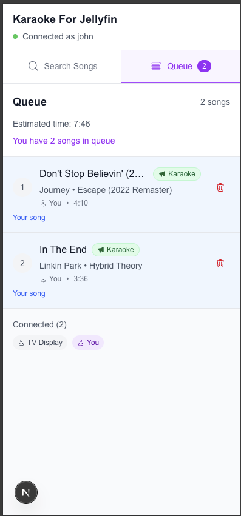
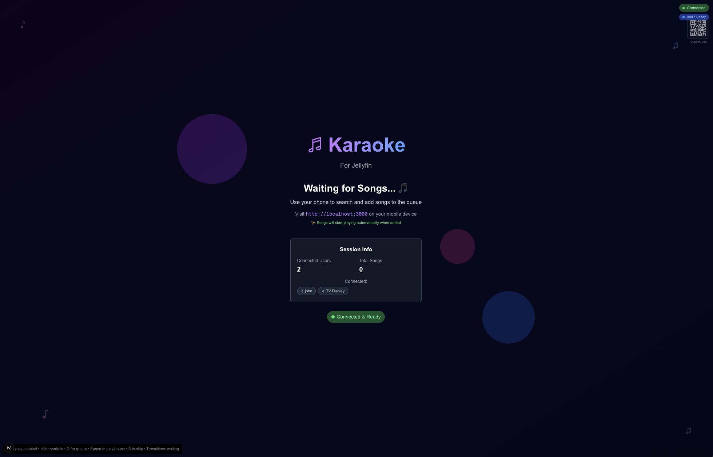
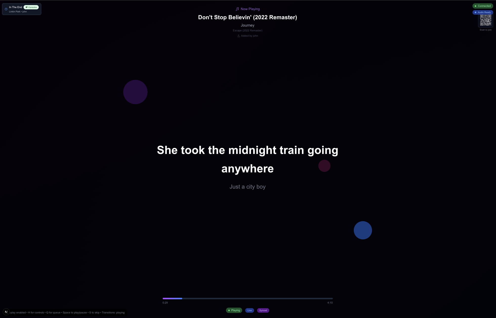
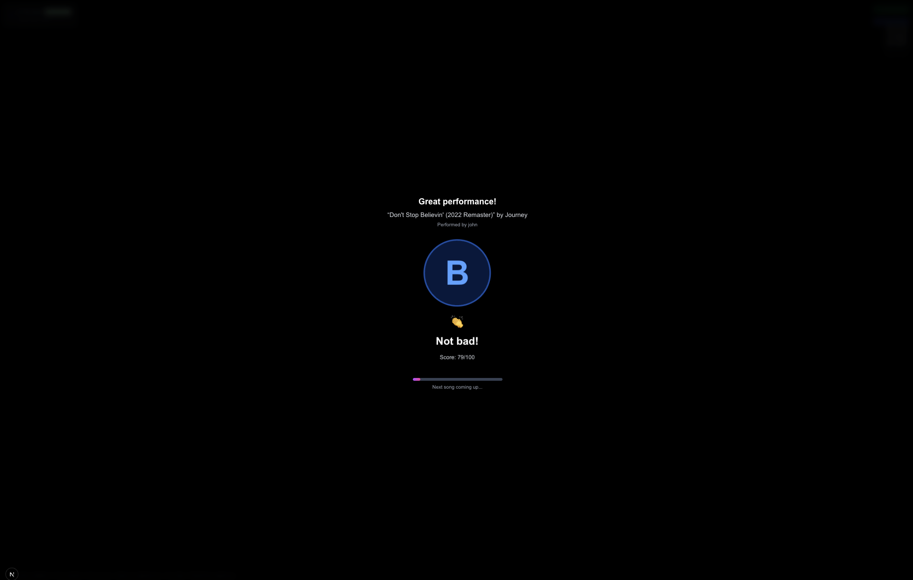
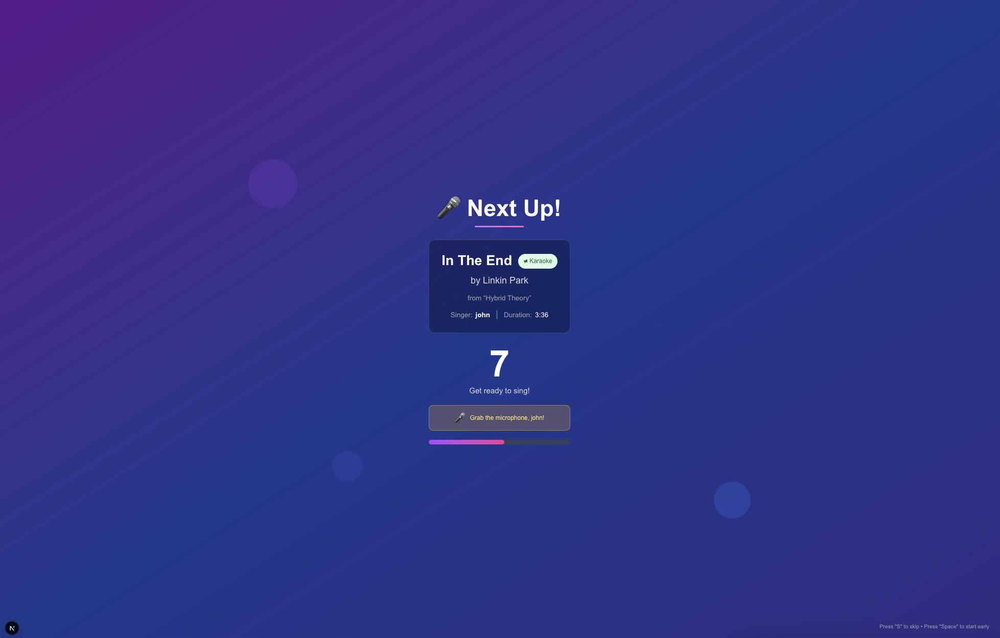

# Karaoke For Jellyfin

[](https://github.com/your-username/karaoke-for-jellyfin/actions/workflows/docker-publish.yml)
[](https://hub.docker.com/r/mrorbitman/karaoke-for-jellyfin)

A web-based karaoke system that integrates with Jellyfin media server to provide karaoke functionality.

The system has three main interfaces:

1. **Mobile Interface** (`<hostname>/`): Search and queue songs from your phone
2. **TV Display** (`<hostname>/tv`): Full-screen karaoke experience for the big screen
3. **Admin Interface** (`<hostname>/admin`): Host controls for managing playback and the karaoke session

### Mobile Interface

Use your phone to search and queue songs while others sing along on the TV.

| Search & Browse                                                             | Add Songs                                                            | Manage Queue                                                         |
| --------------------------------------------------------------------------- | -------------------------------------------------------------------- | -------------------------------------------------------------------- |
|  |             |          |
| Search by artist, playlist, or song title with real-time results            | Add songs to the queue with server confirmation and loading feedback | View and manage the current queue with drag-to-reorder functionality |

### TV Display

Full-screen karaoke experience with lyrics, performance feedback, and queue management.

| Auto-Play & Controls                                            | Sing-Along Lyrics                                                          | Performance Rating                                                               | Next Song Countdown                                           |
| --------------------------------------------------------------- | -------------------------------------------------------------------------- | -------------------------------------------------------------------------------- | ------------------------------------------------------------- |
|  |                 |                   |        |
| Automatic playback when songs are added with host controls      | Full-screen synced lyrics, with word-by-word highlighting for Enhanced LRC | Performance ratings and feedback after each song. (These are just random. Shhh!) | Smooth transitions with next song preview and countdown timer |

### Admin Interface

Mobile-optimized host controls for managing the karaoke session.

#### Playback Controls

- **Play/Pause**: Control song playback
- **Skip**: Move to the next song in queue
- **Seek**: Jump to any position in the current song
- **Volume Control**: Adjust system volume and mute/unmute
- **Lyrics Timing**: Fine-tune lyrics synchronization with ±10 second adjustment

#### Queue Management

- **View Queue**: See all pending songs with position, title, artist, and duration
- **Queue Status**: Real-time count of songs in queue
- **Song Details**: View who added each song to the queue

#### Emergency Controls

- **Emergency Stop**: Immediately stop all playback
- **Restart Song**: Jump back to the beginning of the current song
- **Mute Audio**: Quickly silence the system
- **System Status**: Monitor connection status, active users, and queue length
- **Cache Management**: View cache status and clear cached data

#### Features

- **Real-time Updates**: All controls sync instantly with the TV display
- **User Management**: Admin identification with persistent login
- **Connection Monitoring**: Visual indicators for system connectivity
- **Mobile Optimized**: Touch-friendly interface designed for phones and tablets

---

## Features

- **Mobile Interface**: Search and queue songs from your phone
- **TV Display**: Full-screen lyrics display and playback control
- **Sing-Along Lyrics**: Line-synced LRC plus word-by-word highlighting for Enhanced LRC (`.lrc`/`.elrc` with `<mm:ss.xx>` word tags)
- **Admin Interface**: Comprehensive host controls for session management
- **Jellyfin Integration**: Leverages your existing Jellyfin media library
- **Karaoke Videos (MP4)**: Plays video files with burned-in lyrics (e.g. MP3+CDG converted with ffmpeg) full-screen on the TV, alongside regular audio tracks
- **Real-time Sync**: WebSocket-based real-time updates between devices
- **Progressive Web App**: Install on mobile/desktop for native app experience
- **Offline Support**: Core functionality works without internet connection
- **Smart Caching**: Intelligent cache management with update detection
- **Cache Clearing**: Built-in tools to resolve update and caching issues

## Getting Started

### Docker Compose (Recommended)

The easiest way to run Karaoke For Jellyfin is using Docker:

```bash
version: "3.8"
services:
  karaoke-app:
    image: mrorbitman/karaoke-for-jellyfin:latest
    ports:
      - 3967:3000
    environment:
      # Jellyfin Configuration
      - JELLYFIN_SERVER_URL=${JELLYFIN_SERVER_URL:-http://localhost:8096}
      - JELLYFIN_API_KEY=${JELLYFIN_API_KEY}
      - JELLYFIN_USERNAME=${JELLYFIN_USERNAME}

      # OPTIONAL Playlist Filtering
      - PLAYLIST_FILTER_REGEX=${PLAYLIST_FILTER_REGEX}

      # OPTIONAL Karaoke video library (name or id). Unset = MusicVideo items only
      - KARAOKE_VIDEO_LIBRARY=${KARAOKE_VIDEO_LIBRARY}
      # OPTIONAL Auto-queue a playlist whenever the queue is empty
      - AUTOPLAY_PLAYLIST=${AUTOPLAY_PLAYLIST}
      - AUTOPLAY_PLAYLIST_SHUFFLE=${AUTOPLAY_PLAYLIST_SHUFFLE:-false}

      # OPTIONAL TV Display Timing Configuration (in milliseconds)
      - RATING_ANIMATION_DURATION=${RATING_ANIMATION_DURATION:-15000}
      - NEXT_SONG_DURATION=${NEXT_SONG_DURATION:-15000}
      - CONTROLS_AUTO_HIDE_DELAY=${CONTROLS_AUTO_HIDE_DELAY:-10000}
      - AUTOPLAY_DELAY=${AUTOPLAY_DELAY:-500}
      - QUEUE_AUTOPLAY_DELAY=${QUEUE_AUTOPLAY_DELAY:-1000}
      - TIME_UPDATE_INTERVAL=${TIME_UPDATE_INTERVAL:-2000}

      # System Configuration
      - NODE_ENV=production
      - PORT=3000
      - HOSTNAME=0.0.0.0
    restart: always
networks: {}

```

#### Environment Variables

| Variable                | Description                                                                                                                                                                                     | Default | Required |
| ----------------------- | ----------------------------------------------------------------------------------------------------------------------------------------------------------------------------------------------- | ------- | -------- |
| `JELLYFIN_SERVER_URL`   | URL of your Jellyfin server                                                                                                                                                                     | -       | Yes      |
| `JELLYFIN_API_KEY`      | Jellyfin API key                                                                                                                                                                                | -       | Yes      |
| `JELLYFIN_USERNAME`     | Jellyfin user whose library is searched                                                                                                                                                         | -       | Yes      |
| `PLAYLIST_FILTER_REGEX` | Only show playlists whose names match this regex                                                                                                                                                | -       | No       |
| `KARAOKE_VIDEO_LIBRARY` | Name or id of a Jellyfin library holding karaoke videos (MP4 etc.). When set, every video in that library is searchable and plays full-screen. When unset, only `MusicVideo` items are included | -       | No       |

See [DOCKER.md](DOCKER.md) for the TV display timing variables.

### Karaoke Videos (MP4 with burned-in lyrics)

Besides audio tracks with synced lyrics, the app can queue **videos whose lyrics are already part of the picture** - for example MP3+CDG karaoke files converted to MP4 with ffmpeg. Video entries show a small **Video** badge on phones, and on the TV the video plays full-screen with no text-lyrics overlay. Queueing, skipping, play/pause, volume, ratings and the next-up flow work exactly like audio songs.

1. Convert your MP3+CDG pairs, e.g. `ffmpeg -i song.cdg -i song.mp3 -c:v libx264 -pix_fmt yuv420p -c:a aac song.mp4`
2. Put the MP4s in a Jellyfin library (a **Music Videos** or **Home Videos** library works well) and let Jellyfin scan it. Files named `Artist - Title.mp4` get their artist/title parsed when Jellyfin has no artist metadata.
3. Either tag the items as Music Videos in Jellyfin, or set `KARAOKE_VIDEO_LIBRARY` to that library's name (or id) so all its videos are included.
4. Search for the song on your phone and add it to the queue as usual.

The TV loads videos through the app's stream proxy (`/api/stream/<id>?type=video`), which requests Jellyfin's direct stream (`/Videos/<id>/stream?static=true`) server-side - your API key never reaches the browser. Use a browser-friendly container/codec (MP4 with H.264 + AAC) since the video is played natively without transcoding.

#### Auto-queue a playlist (hands-free mode)

Running the TV page on a tablet for a kid, or want music to start on its own
instead of building a queue by hand? Point the server at a Jellyfin playlist:

| Variable                    | Description                                                                                                                                                               | Default |
| --------------------------- | ------------------------------------------------------------------------------------------------------------------------------------------------------------------------- | ------- |
| `AUTOPLAY_PLAYLIST`         | Name (case-insensitive) or Jellyfin id of a playlist. Whenever the queue is empty — when the TV page connects and after the last song finishes — its songs are queued up. | _unset_ |
| `AUTOPLAY_PLAYLIST_SHUFFLE` | Set to `true` to shuffle the playlist each time it is queued.                                                                                                             | `false` |

Notes:

- Leaving `AUTOPLAY_PLAYLIST` unset keeps the current behaviour (empty queue waits for phones).
- Only songs with lyrics are queued, the same rule the phone UI applies.
- Songs added from a phone are interleaved ahead of the playlist by the fair-rotation queue, so a kid can still pick a favourite without waiting for the whole playlist.
- The playlist lookup ignores `PLAYLIST_FILTER_REGEX`, so the auto-queued playlist does not have to be visible in the phone UI.
- Queued songs show the playlist name as "added by", and the TV waiting screen shows which playlist is in use.

### Local Development

### Prerequisites

- Node.js 18+
- A running Jellyfin server
- Audio files (and optionally karaoke MP4 videos) in your Jellyfin library

### Installation

1. Clone the repository
2. Install dependencies:

   ```bash
   npm install
   ```

3. Copy the environment configuration:

   ```bash
   cp .env.local.example .env.local
   ```

4. Update `.env.local` with your Jellyfin server details

5. Run the development server:

   ```bash
   npm run dev
   ```

6. Open the interfaces:
   - **Mobile**: [http://localhost:3000](http://localhost:3000)
   - **TV Display**: [http://localhost:3000/tv](http://localhost:3000/tv)
   - **Admin**: [http://localhost:3000/admin](http://localhost:3000/admin)

## Usage

### Setting Up a Karaoke Session

1. **Start the TV Display**: Open `<hostname>/tv` on your main display
2. **Admin Setup**: Open `<hostname>/admin` on your phone/tablet for host controls
3. **Share with Guests**: Have guests scan the QR code or visit `<hostname>/` to add songs

### Host Controls

The admin interface provides three main control panels:

- **Playback**: Control current song playback, volume, and lyrics timing
- **Queue**: Monitor upcoming songs and queue status
- **Emergency**: Quick access to emergency controls, system status, and cache management

### Lyrics Formats

Lyrics are fetched from Jellyfin first (`/Audio/{id}/Lyrics`), then from local files in `LYRICS_PATH`, `JELLYFIN_MEDIA_PATH`, or the bundled `lyrics/` folder (matched by song ID; `.lrc`, `.srt`, `.vtt`, `.txt`).

- **LRC** (`[mm:ss.xx]Line`): the current line is highlighted as a whole.
- **Enhanced LRC** (`[mm:ss.xx]<mm:ss.xx>Word <mm:ss.xx>by <mm:ss.xx>word`): each word lights up as it is sung, with a smooth fill on the current word. Works with the admin **lyrics offset** control. Jellyfin 10.11+ parses `.lrc`/`.elrc` word tags into per-word cues, which the TV display uses directly; raw `.lrc` files with inline `<mm:ss.xx>` tags are parsed by the app itself. Lines without word tags render exactly as plain LRC, so mixed files work. See `lyrics/sample-enhanced.lrc` for an example.

### Tips for Hosts

- Use the **lyrics offset** control if lyrics appear too early or late
- The **emergency stop** button immediately halts playback for technical issues
- Monitor the **system status** panel to track active users and connection health
- **Volume controls** affect the entire system, not just individual songs

### Troubleshooting Updates and Caching

If the app isn't showing the latest updates or behaving unexpectedly:

1. **Check for Updates**: The app will automatically notify you when updates are available
2. **Quick Cache Clear**: Use the cache status panel in the admin interface for a quick clear
3. **Full Cache Clear**: Visit `<hostname>/clear-cache` for comprehensive cache management
4. **Manual Refresh**: Force refresh your browser (Ctrl+F5 or Cmd+Shift+R)

The cache clearing page (`/clear-cache`) provides:

- Complete cache information and statistics
- Clearing of service worker caches
- Clearing of browser storage (localStorage, sessionStorage)
- Clearing of IndexedDB databases
- Automatic redirect to fresh app instance

## Project Structure

```
src/
├── app/
│   ├── api/          # API routes
│   ├── admin/        # Admin interface
│   ├── clear-cache/  # Cache clearing page
│   ├── tv/           # TV display interface
│   └── page.tsx      # Mobile interface
├── components/
│   ├── mobile/       # Mobile-specific components
│   ├── tv/           # TV-specific components
│   ├── CacheStatus.tsx    # Cache management component
│   └── PWAInstaller.tsx   # PWA installation and updates
├── hooks/
│   └── useServiceWorker.ts # Service worker management hook
├── lib/              # Utility libraries
├── services/         # Business logic services
└── types/            # TypeScript type definitions
```

## Development Status

This project is currently in development. See the implementation tasks in `.kiro/specs/self-hosted-karaoke/tasks.md` for current progress.

## License

MIT — see [LICENSE](LICENSE).
